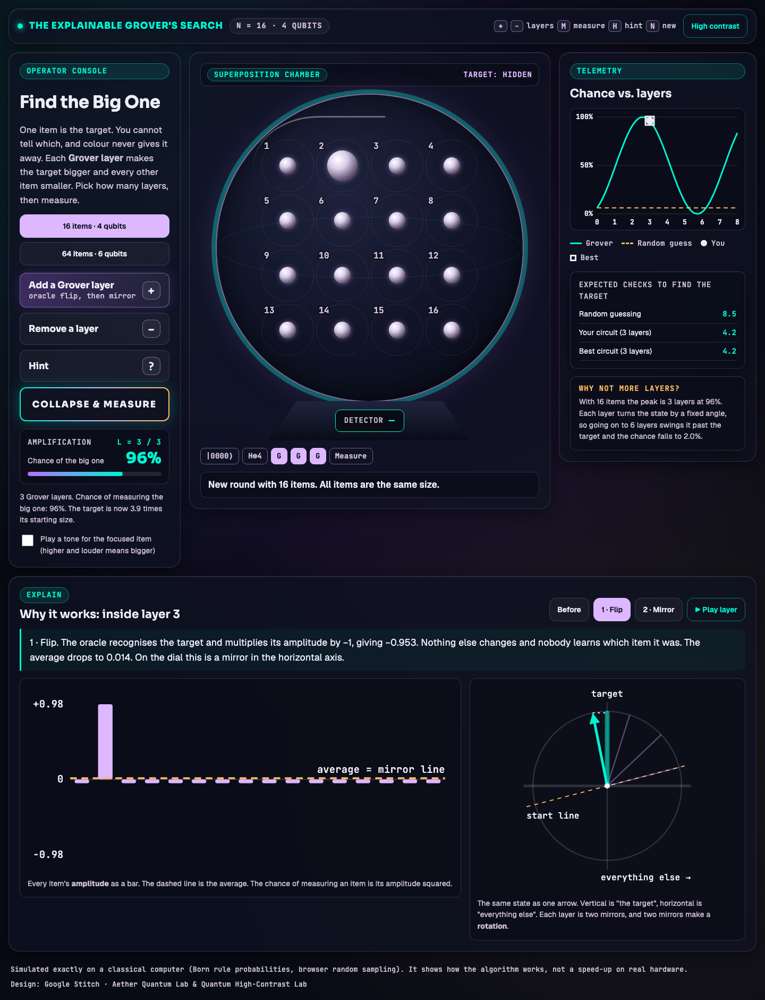
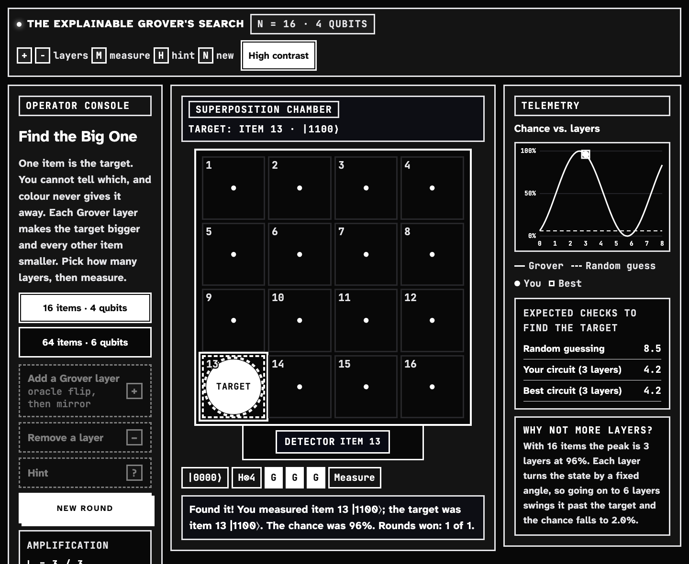
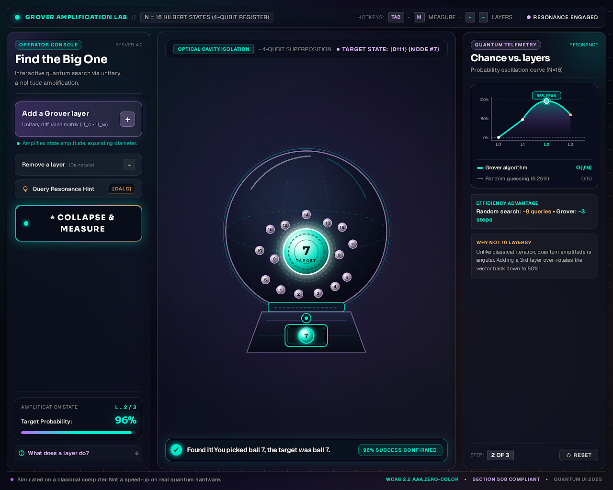

# The Explainable Grover's Search

*This effort is supported by Qollab & IonQ.* Built for the Qollab × IonQ Global Quantum Hackathon 2026 (team The Quantubians).

**Find the Big One** is a browser game that teaches Grover's quantum search algorithm. It also shows *why* each step works.

One of 16 (or 64) items is secretly the target. You cannot see which one. Each **Grover layer** you add makes the target a little bigger and every other item a little smaller. Choose how many layers to use, then measure. Too few layers and the target is still small. Too many and it shrinks again. The game is about finding the sweet spot, about π/4·√N layers.



## Why "explainable"

Most Grover demos show the result. This one takes apart the layer you just added and draws it twice:

| View | What you see |
| --- | --- |
| **Amplitude bars** | Every item's amplitude, with the average as a dashed line. **1 · Flip:** the oracle turns the target's bar upside down. **2 · Mirror:** every bar is reflected about the average. The flipped bar was furthest below it, so it lands furthest above it. |
| **Rotation dial** | The same state as one arrow between "everything else" and "the target". The flip is a mirror in one line and the diffuser is a mirror in another. Two mirrors make a rotation of 2θ, which explains the fixed step per layer, the √N speed-up and the overshoot. |

Step through **Before → Flip → Mirror** by hand, or press **Play layer**. Every caption uses the real numbers for the current round.

## Accessible by design

- **Size, never colour.** Before you measure, all items look alike except for their size. Colour never hints at the target.
- **Two themes from Google Stitch** (see below). The default is a glass "lab" look. One click switches to a monochrome high-contrast mode with large text, thick borders and big touch targets. The page picks high contrast automatically if the OS asks for more contrast.
- **Keyboard first.** Arrow keys move around the board. `+` / `−` add or remove layers, `M` measures, `H` gives a hint, `N` starts a new round.
- **Screen reader and sound.** Every item announces its size relative to the start. Live regions report each change. An optional tone gets higher and louder for bigger items.
- **Respects reduced motion.**



## Designed with Google Stitch

The interface comes from the Stitch project **"Find the Big One – Grover game"**. It has three design systems, two of which are used here:

| Stitch design system | Used as |
| --- | --- |
| **Aether Quantum Lab** | Default theme: violet / cyan / amber glass panels, Sora + Geist type, the "operator console / chamber" stage with telemetry and explain as floating windows, and the glass-globe chamber with its detector pedestal |
| **Quantum High-Contrast Lab** | High-contrast theme: pure monochrome, square corners, Atkinson Hyperlegible Next + JetBrains Mono, 20px text floor, inverted focus and pressed states, hard offset shadows |

The exported specs live in [`docs/stitch/`](docs/stitch/), with the generated reference screen. Both themes are CSS custom properties in [`main.css`](main.css), switched by `data-theme` on `<html>`.

Where the generated mock-up and the physics disagreed, the physics won:
- The target stays hidden (no colour and no label) until you measure.
- The peak for N = 16 is at 3 layers (96.1%), not 2.
- The page claims no accessibility certifications it has not been tested for.



## Run it on a real quantum backend

On the hackathon platform, measurements run the actual Grover circuit in Qiskit on the pre-created `backend`. The JS simulation still draws the bars and the dial, because a backend only returns counts, not amplitudes.

- **Collapse & measure** builds your circuit (H on every qubit, then *k* × [oracle, diffuser], then measure), transpiles it for the backend and runs **1 shot**. The detector shows what the backend returned.
- **Telemetry → Check it on the real circuit** unlocks after you measure. It runs the same circuit **1,000 shots** and compares how often the target came up with the predicted sin²((2k+1)θ). It stays locked before measuring, because a histogram would give the target away.
- The chip in the top bar shows **Backend: *name*** when connected. It shows **Exact simulation** when there is no Qiskit or no `backend` (hover for the reason). In that case every measurement samples the exact simulation, and the page says so.

## Upload to the platform

The platform runs `index.html` + `main.js` and adds `main.css` automatically. It may not serve other files, so the modules in `js/` are bundled into one self-contained `main.js`:

```bash
python3 build.py          # writes dist/ (index.html, main.js, main.css) and dist.zip
```

Upload the **contents of `dist/`** (or `dist.zip`). Keep the platform's own `requirements.txt` and libraries, which provide Qiskit. The bundle runs only once, even if the platform injects `main.js` and `index.html` also loads it.

The bundle reaches Qiskit with `import('qiskit')`, and falls back to `pyodide.pyimport('qiskit')`. If the chip still says *Exact simulation* on the platform, check the browser console for `[grover]` lines. Then rebuild with the static import used in the platform's template:

```bash
python3 build.py --static-qiskit
```

## Run it locally

No dependencies. This serves `dist/` exactly as it will be uploaded, and rebuilds it on every page load:

```bash
python3 serve.py          # http://localhost:8800
```

## The maths, briefly

- Start in the uniform state: every amplitude is 1/√N.
- One layer = **oracle** (flip the target's sign) then **diffuser** (reflect every amplitude about the mean, i.e. 2|s⟩⟨s| − I).
- With θ = asin(1/√N), after k layers P(target) = sin²((2k+1)θ). This peaks at k ≈ π/(4θ) − ½ ≈ (π/4)√N.
- Random guessing needs (N+1)/2 checks on average. Grover needs about √N.

The simulation in [`js/grover_sim.js`](js/grover_sim.js) is a pure module with no DOM. Probabilities are exact (Born rule). [`js/quantum.js`](js/quantum.js) writes the same layers as Qiskit gates. The oracle is X on the target's 0-bits, then multi-controlled Z, then X again. The diffuser is H·X·MCZ·X·H.

## Tests

The tests cover three things:

- The browser simulation matches an independent NumPy implementation and the closed form.
- The Qiskit gate list from `quantum.js` gives the same probabilities as a real Qiskit `Statevector`.
- The backend adapter behaves correctly against a mock Pyodide-style backend, and the upload bundle is a single valid script.

```bash
uv run --no-project --with pytest --with numpy --with qiskit python -m pytest -q tests
```

Requires Node on your `PATH`. The Node tests skip cleanly without it, and the Qiskit cross-check skips without `qiskit`.

## Project layout

```
index.html            page structure (console · chamber stage, telemetry + explain windows, briefing)
main.css              both Stitch themes as CSS tokens
js/grover_sim.js      pure Grover simulation (shared with the tests)
js/quantum.js         the same circuit in Qiskit, run on the platform's `backend`
js/main.js            game, board, chart, windows, hotkeys, theme switch
js/intro.js           the briefing: gumball drop, then the story one line at a time
js/explain.js         amplitude bars + rotation dial, step by step
build.py              bundles js/ into dist/main.js for upload (no dependencies)
serve.py              builds, then serves dist/ locally
tests/                NumPy + Qiskit cross-checks, adapter and bundle checks
docs/stitch/          Stitch design-system specs and reference screen
```

## Honest note

The bars and the dial are an exact classical simulation. When the platform provides a backend, measurements come from running the Qiskit circuit on it, and the page names that backend. When it does not, the page says *Exact simulation*. Either way, a 16- or 64-item search shows how the algorithm behaves, not a speed-up. The oracle here is built from the known target. A real advantage needs an oracle that checks a condition without already knowing the answer.

Built at the Qollab hackathon.
